<div align="center">

<picture>
  <source media="(prefers-color-scheme: dark)" srcset=".github/assets/banner-dark.svg">
  
</picture>

**Comparable mobile performance claims, measured on the same device.**<br>
Versioned workloads, budgets and evidence contracts. This repository publishes the comparison contract and verifier, not a predeclared winner.

[](https://github.com/push-in/pam-native-benchmarks/actions/workflows/ci.yml)

[Run it](#install) · [Quick example](#quick-example) · [Reference run](#reference-run) · [Docs](#docs) · [Issues](https://github.com/push-in/pam-native-benchmarks/issues)

</div>

<a id="install"></a>
## <picture></picture> Install

The harness is Python 3 scripts plus JSON contracts; there is no package to install:

```sh
git clone https://github.com/push-in/pam-native-benchmarks.git
cd pam-native-benchmarks
python3 -m unittest test_compare.py
```

Measure PAM Native inside a PAM Native project with `pam mobile benchmark path/to/project` (Android `:macrobenchmark` module, minified `benchmark` target) and generate the startup Baseline Profile with `pam mobile profile path/to/project`.

<a id="quick-example"></a>
## <picture></picture> Quick example

```sh
# Compare frameworks: a table is emitted only for measurements present in every report
python3 compare.py \
  --pam evidence/pam --react-native evidence/react-native \
  --flutter evidence/flutter --native evidence/platform-native \
  --output evidence/framework-matrix.md

# Block a release when startup, mount, memory or tail-frame latency regresses
python3 gate.py --report results/pam

# Hash every artifact plus contract.json and budgets.json, then verify
python3 evidence.py results/pam 1
python3 evidence.py results/pam 1 --verify
```

React Native is the required baseline; Flutter and platform-native reports are optional. `compare.py` refuses to produce a table if an implementation omits a required scenario or metric, and publishes every shared median, P50, P95, P99 and maximum. Suite ID `1` is a PAM baseline, `2` a framework comparison. The full workflow is in [docs/harness.md](docs/harness.md).

<a id="platform-support"></a>
## <picture></picture> Platform support

| Platform | Support | Notes |
| --- | --- | --- |
| Android | Physical device, API 31+ | AndroidX Macrobenchmark; release-like, airplane mode, thermal status at most 1 (`contract.json`) |
| iOS | XCTest metrics | Named as the iOS execution path; the shipped scenarios and gate target Android reports |
| Tooling | Python 3 | CI runs Python 3.14 (`.github/workflows/ci.yml`) |

<a id="scenarios"></a>
## <picture></picture> Scenarios

Three identical, automation-friendly scenarios (`contract.json`):

1. cold startup from clean application state until `reportFullyDrawn()` (10 iterations);
2. 30 keyed property patches, including memory plus decode/mount trace sections;
3. repeated flings through 10,000 recycled rows.

An equivalent React Native/New Architecture app must expose the accessibility targets and payloads declared in `contract.json`. Nitro Modules is not itself a UI renderer, so its module-call latency must not be confused with list or startup performance. `budgets.json` is stricter than a "benchmark completed" check: absent metrics fail, and list P95/P99 are gated independently so a good median cannot hide visible jank.

<a id="reference-run"></a>
## <picture></picture> Reference run

[`REFERENCE.md`](REFERENCE.md) records the latest physical-device PAM Native baseline: Samsung Galaxy S23 Ultra (`SM-S918B`), Android 16/API 36, locked benchmark CPU clocks, minified `benchmark` build, 2026-07-23.

| Scenario | Metric | Result |
| --- | --- | ---: |
| cold startup, 10 runs | time to fully drawn, median | 408.258 ms |
| 30 property patches | mount sum, median | 25.053 ms |
| 10,000-row list, 6 swipes | frame overrun P50 / P95 | 0.835 / 23.483 ms |

The list P99 overrun was 67.872 ms, so tail latency remains an explicit optimization target. These values are a PAM Native baseline, not evidence of a speedup over React Native or Nitro Modules: a valid multiplier needs a React Native report produced from `contract.json` on the same device, OS, payload and thermal state, processed by `compare.py`.

<a id="measurement-rules"></a>
## <picture></picture> Measurement rules

- Same physical device, release-like non-debuggable targets, a stable thermal state and the same compilation mode.
- Keep raw JSON and Perfetto traces as CI artifacts.
- Record APK/AAB size separately: it is a build artifact, not a runtime metric.
- Results are device and build specific; this repository does not publish universal marketing numbers.

The harness originated in [`push-in/pam-native`](https://github.com/push-in/pam-native/tree/v0.7.0/benchmarks/mobile) and is published independently so competitors can inspect, fork, reproduce, and challenge every comparison.

<a id="docs"></a>
## <picture></picture> Docs

- [Harness and evidence workflow](docs/harness.md)
- [Physical-device reference run](REFERENCE.md)
- [Benchmark contract](contract.json)
- [Release budgets](budgets.json)
- [PAM Native overview](https://push-in.github.io/pam-docs/native/overview/)
- [Report an issue](https://github.com/push-in/pam-native-benchmarks/issues)

<a id="pam-ecosystem"></a>
## <picture></picture> Part of the PAM ecosystem

<p align="center"><picture>
  <source media="(prefers-color-scheme: dark)" srcset=".github/assets/pam-wordmark-dark.svg">
  
</picture></p>

PAM runs PHP natively on servers, desktops and phones. This repository is one piece of it.

| [**PAM**](https://github.com/push-in/pam) | [**PAM Desktop**](https://github.com/push-in/pam-desktop) | [**PAM Native**](https://github.com/push-in/pam-native) | [**Ecosystem**](https://github.com/push-in/pam#ecosystem) |
| --- | --- | --- | --- |
| the runtime and CLI | native desktop apps in PHP | native Android and iOS apps in PHP | every official package and plugin |

<sub>Docs: [push-in.github.io/pam-docs](https://push-in.github.io/pam-docs/introduction/) · [Issues](https://github.com/push-in/pam-native-benchmarks/issues)</sub>

<p align="center"><sub>No license file yet · Made in Brazil by Pushin</sub></p>
